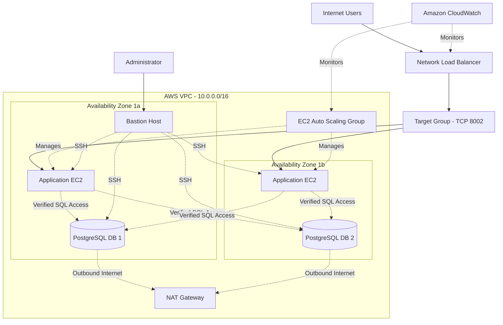
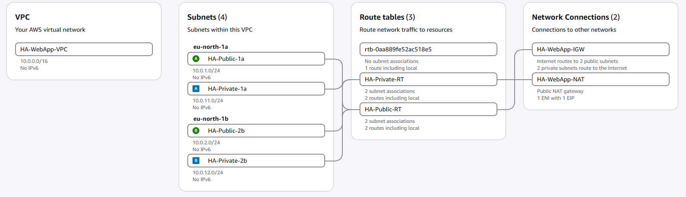
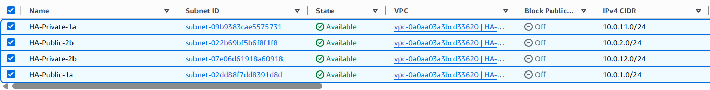
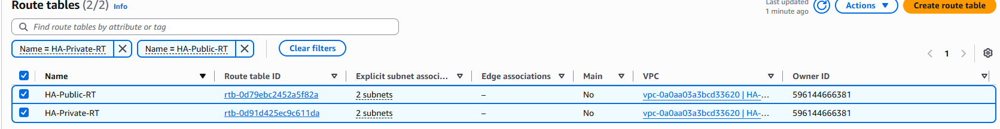
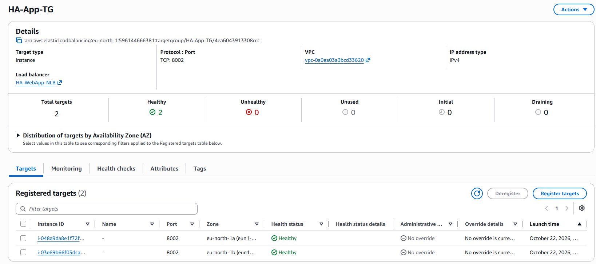
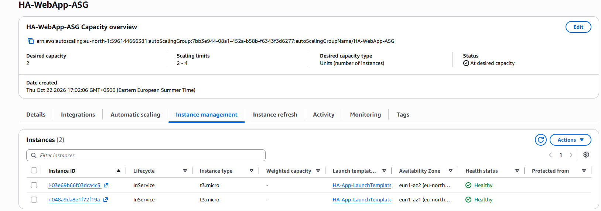
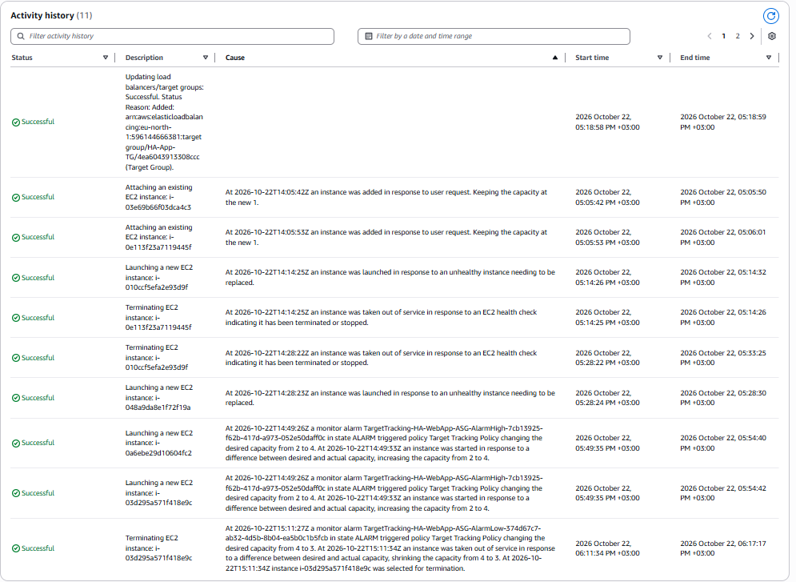
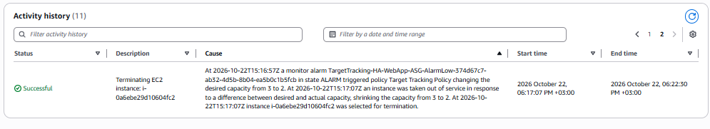
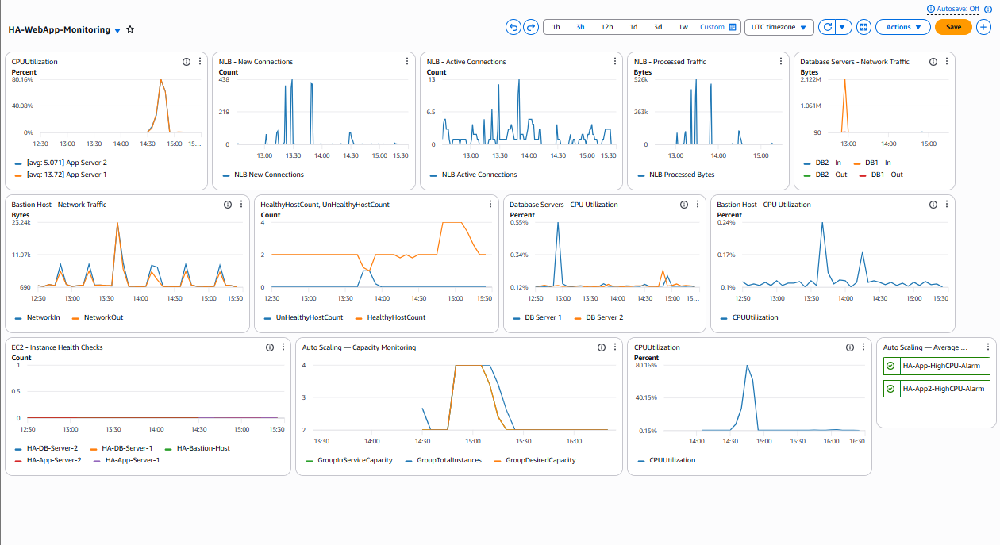

# AWS High Availability Web Application

**A hands-on AWS cloud infrastructure project demonstrating multi-AZ networking, load balancing, EC2 Auto Scaling, private PostgreSQL databases, monitoring, and failure recovery.**

## 1. Project Overview

This project demonstrates the deployment and testing of a highly available web application infrastructure using Amazon Web Services (AWS).

The infrastructure was built using the **AWS Management Console and AWS CLI**, with an emphasis on practical cloud networking, application availability, infrastructure security, monitoring, and automated scaling.

The application tier is deployed across two Availability Zones and uses an internet-facing Network Load Balancer to distribute traffic between EC2 instances managed by an Auto Scaling Group.

Two PostgreSQL database servers are deployed in private subnets, with database connectivity secured through AWS Security Groups and PostgreSQL authentication.

### Project Objectives

- Design and deploy a custom multi-AZ AWS VPC.
- Configure public and private subnets with appropriate routing.
- Deploy a Network Load Balancer for application traffic.
- Configure EC2 Auto Scaling and automatic instance replacement.
- Secure administrative access using a Bastion Host.
- Deploy PostgreSQL on private EC2 instances.
- Configure and verify authenticated database connectivity.
- Monitor infrastructure using Amazon CloudWatch.
- Validate availability and performance through load and failure testing.

## 2. Architecture

**AWS Region:** `eu-north-1` (Stockholm)

**VPC CIDR:** `10.0.0.0/16`



*Database connections represent verified connectivity using the PostgreSQL client. The Python web application itself has not been integrated with PostgreSQL.*

## 3. AWS Services Used

| AWS Service | Purpose |
|---|---|
| Amazon VPC | Isolated virtual network |
| EC2 | Application, database, and Bastion servers |
| Network Load Balancer | Distributes incoming TCP traffic |
| EC2 Auto Scaling | Automatic scaling and unhealthy-instance replacement |
| Internet Gateway | Internet routing for public subnets |
| NAT Gateway | Outbound IPv4 connectivity for private subnets |
| Security Groups | Instance and load-balancer traffic control |
| Amazon CloudWatch | Infrastructure metrics, dashboards, and alarms |
| EC2 Launch Template | Configuration of automatically launched application instances |

**Additional technologies:** Ubuntu, Python, PostgreSQL, Linux systemd, AWS CLI, PuTTY/SSH, and Grafana Cloud k6.

## 4. Network Design

Four subnets are distributed across two Availability Zones.

| Subnet | CIDR | Availability Zone | Resources |
|---|---|---|---|
| HA-Public-1a | 10.0.1.0/24 | eu-north-1a | Application EC2, Bastion, NAT |
| HA-Public-2b | 10.0.2.0/24 | eu-north-1b | Application EC2 |
| HA-Private-1a | 10.0.11.0/24 | eu-north-1a | PostgreSQL DB 1 |
| HA-Private-2b | 10.0.12.0/24 | eu-north-1b | PostgreSQL DB 2 |

**Routing design:**

- Public subnets use a default route to an Internet Gateway.
- Private subnets use a default route to a public NAT Gateway.
- Local VPC traffic uses the VPC's local route.
- Database EC2 instances have no public IPv4 addresses.

A single NAT Gateway in `eu-north-1a` is used by both private subnets.

## 5. Security Architecture

Four dedicated Security Groups separate access responsibilities.

| Security Group | Inbound Access |
|---|---|
| HA-NLB-SG | TCP 80 from internet clients |
| HA-App-SG | TCP 8002 from NLB Security Group; SSH from Bastion Security Group |
| HA-Bastion-SG | SSH from an authorized administrator IP |
| HA-DB-SG | PostgreSQL 5432 from Application Security Group; SSH from Bastion Security Group |

The Bastion Host provides administrative SSH access to database and application instances.

PostgreSQL uses a dedicated `ha_app_user` login role with read-only access to the sample table. Client authentication uses SCRAM-SHA-256 and permits the application subnet CIDR ranges.

## 6. Application Tier

The web application is a lightweight Python HTTP service listening on TCP port `8002`.

The application runs under Linux `systemd`, allowing it to be managed as a service.

An EC2 Launch Template contains the configuration and bootstrapping script needed for new Auto Scaling instances.

The internet-facing Network Load Balancer accepts traffic on TCP port `80` and forwards it to healthy application targets on port `8002`.

**Target group health checks:**

- Protocol: HTTP
- Path: `/`
- Port: Traffic port (`8002`)
- Healthy threshold: 5
- Unhealthy threshold: 2

## 7. EC2 Auto Scaling

The application is managed by `HA-WebApp-ASG`.

| Configuration | Value |
|---|---|
| Minimum capacity | 2 |
| Desired capacity at baseline | 2 |
| Maximum capacity | 4 |
| Scaling policy | Target tracking |
| Target CPU utilization | 50% |
| Health check type | ELB |
| Health check grace period | 300 seconds |

The Auto Scaling Group spans two Availability Zones and is integrated with the NLB target group.

### Self-Healing Test

An Auto Scaling-managed EC2 instance was deliberately terminated.

The group detected the loss, launched a replacement instance, and automatically registered it with the target group.

**Result:** Automatic instance replacement verified.

### Dynamic Scale-Out Test

CPU-intensive workloads were generated using `stress-ng` on both application servers.

The observed CPU utilization increased to approximately 80%.

The target-tracking scaling policy responded by increasing desired capacity:

**2 → 4 instances**

Both additional instances were successfully launched and became healthy NLB targets.

### Automatic Scale-In Test

After the CPU workload stopped, utilization decreased to approximately 0.16%.

The low-CPU CloudWatch alarm triggered the scaling policy, and AWS reduced desired capacity:

**4 → 3 → 2 instances**

Extra instances were deregistered and terminated automatically.

**Result:** CPU-based scale-out and scale-in verified.

## 8. High Availability and Load Testing

Load and failover experiments were conducted using Grafana Cloud k6.

| Test | Requests | HTTP Failures | P95 Response Time |
|---|---:|---:|---:|
| 5 VUs / 50 seconds | 167 | 0 | 125 ms |
| 10 VUs / 60 seconds | 411 | 0 | 125 ms |
| 20 VUs / 60 seconds | 817 | 0 | 125 ms |
| Application failover test | 818 | 0 | 125 ms |

During failover testing, the application service on one EC2 instance was stopped while traffic continued through the NLB.

CloudWatch showed a reduction in healthy targets, while the test recorded zero HTTP request failures.

A separate 10-request HTTP availability check during Auto Scaling scale-in returned **10 successful HTTP 200 responses**.

These results demonstrate successful availability checks under the tested conditions; they do not guarantee zero downtime under every possible workload or failure.

## 9. PostgreSQL Database Tier

Two PostgreSQL 16 database servers were deployed on EC2 instances in separate private subnets.

Both servers contain a sample `ha_project` database with a `demo_records` table.

The PostgreSQL configuration was updated to listen on each server's private IP address.

A dedicated application login role was configured with:

- Database connection permission.
- Schema usage permission.
- Read-only SELECT permission on the sample table.
- SCRAM-SHA-256 password authentication.

### Database Connectivity Tests

Authenticated PostgreSQL queries were executed from both application EC2 instances.

| Source | DB Server 1 | DB Server 2 |
|---|---|---|
| Application EC2 — AZ 1a | Passed | Passed |
| Application EC2 — AZ 1b | Passed | Passed |

All four connections successfully executed:

```sql
SELECT COUNT(*) FROM public.demo_records;
```

Each query returned one record.

**Database architecture limitation:** The two databases are independent instances. PostgreSQL replication and automatic database failover were not implemented.

The web application's Python code is not yet connected to the PostgreSQL databases; database access was verified separately using `psql`.

## 10. Amazon CloudWatch Monitoring

A custom dashboard named `HA-WebApp-Monitoring` was created to monitor the infrastructure.

The dashboard includes:

- Application CPU utilization.
- Auto Scaling Group average CPU utilization.
- Desired, total, and InService capacity metrics.
- NLB new and active flows.
- NLB processed traffic.
- Healthy and unhealthy target counts.
- PostgreSQL EC2 CPU and network metrics.
- Bastion Host CPU and network metrics.
- EC2 status checks.
- CPU utilization alarms.

CloudWatch and Auto Scaling activity history were used to validate both scaling directions and observe changes in target health.

## 11. Project Verification Summary

| Verification | Result |
|---|---|
| VPC and subnet deployment | Passed |
| Public and private routing | Passed |
| NAT Gateway availability | Passed |
| Network Load Balancer health checks | Passed |
| Application availability | Passed |
| EC2 Auto Scaling self-healing | Passed |
| CPU-based scale-out | Passed |
| CPU-based scale-in | Passed |
| NLB availability checks during scale-in | Passed |
| PostgreSQL EC2 status checks | Passed |
| PostgreSQL local SQL queries | Passed |
| Authenticated App-to-DB connectivity | 4/4 passed |
| CloudWatch dashboard | Configured |

## 12. Project Limitations and Future Improvements

This is a hands-on AWS infrastructure project rather than a fully production-hardened system.

Potential improvements include:

- Moving application instances into private subnets.
- Using HTTPS/TLS for public web traffic.
- Adding PostgreSQL replication or migrating to Amazon RDS with Multi-AZ support.
- Integrating the Python application with the database tier.
- Using AWS Secrets Manager for database credentials.
- Deploying NAT Gateways across multiple Availability Zones.
- Updating instance-level alarms to use lifecycle-aware monitoring.
- Adding stronger application logging and backup/recovery procedures.

## 13. Project Screenshots

### AWS VPC and Networking






### Network Load Balancer


### EC2 Auto Scaling






### Amazon CloudWatch Monitoring



## 14. Key Learning Outcomes

This project provided practical experience in:

- AWS networking and subnet isolation.
- Security Groups and controlled SSH access.
- EC2 deployment and Linux service management.
- Load balancing and application health checks.
- Auto Scaling target tracking and instance lifecycle management.
- CloudWatch metrics and infrastructure troubleshooting.
- PostgreSQL network configuration and authentication.
- Load testing and availability validation.
- Working with AWS through both Console and CLI.

---

**Project Type:** Hands-on AWS Infrastructure / Cloud Engineering

**AWS Region:** Europe (Stockholm), `eu-north-1`

**Implementation:** AWS Management Console, AWS CLI, Linux, Python, PostgreSQL

**Infrastructure automation:** EC2 Auto Scaling and Launch Templates

**Project Status:** Core infrastructure and connectivity verification completed.
